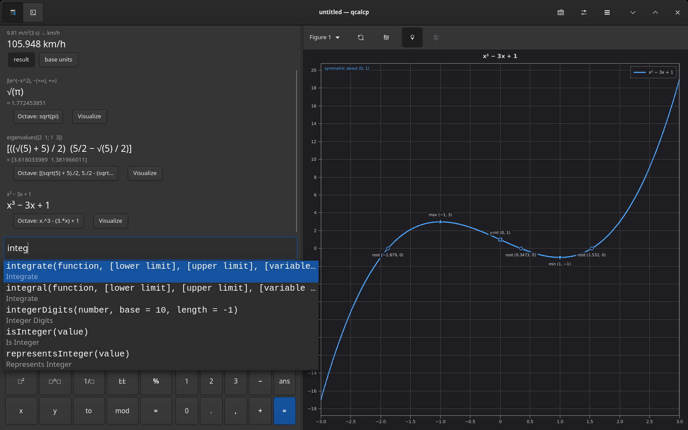
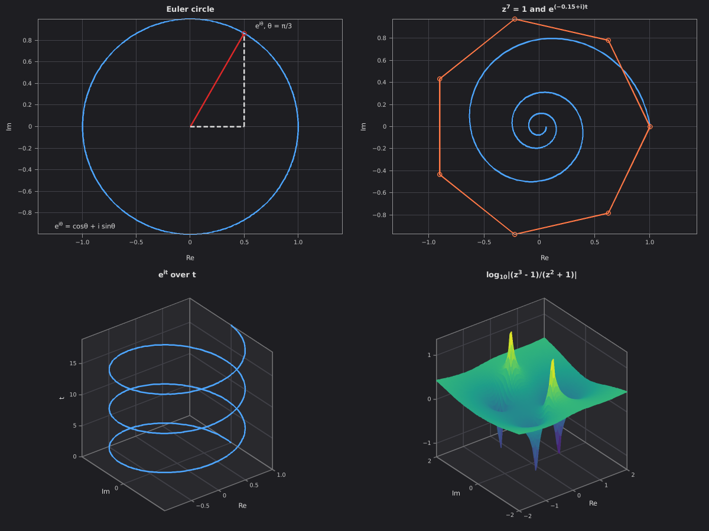
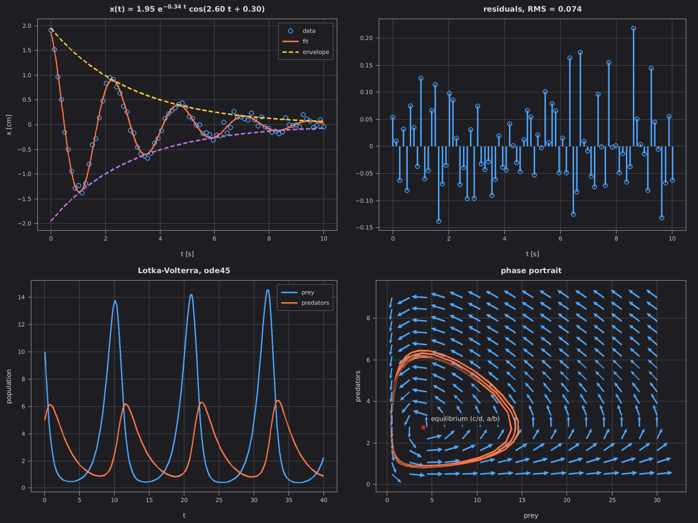
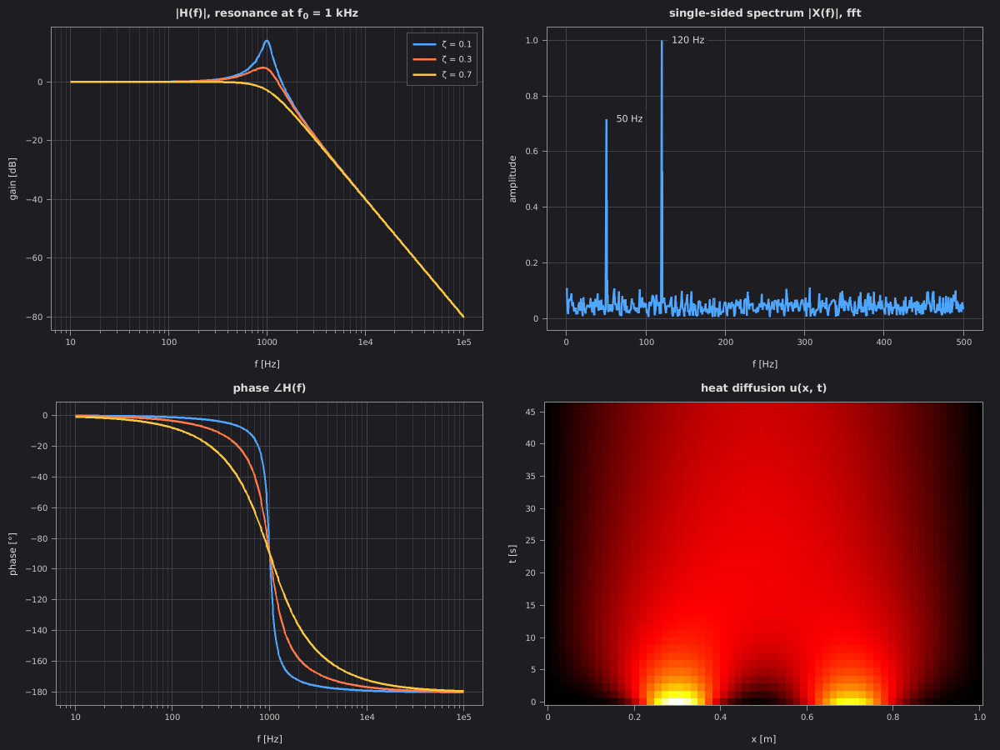
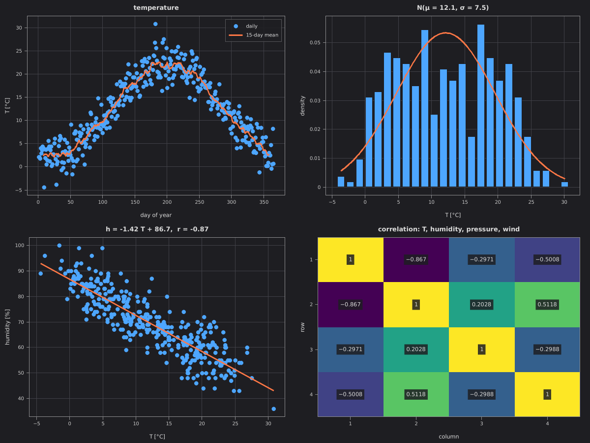
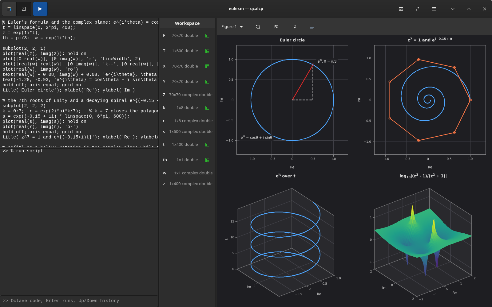
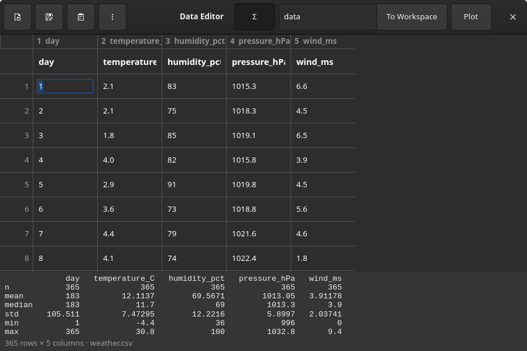

## qcalcp

A calculator, Octave-style interpreter and plotter in one program, with a GTK 4 window, a terminal UI and a command line. Calculator input goes through [libqalculate](https://github.com/Qalculate/libqalculate) (exact fractions, units, symbolic calculus, number bases); scripts run in a built-in interpreter for a large subset of Octave/MATLAB. Answers and plots convert between the two in both directions.

**Status: beta.** Snapshot builds for Linux (AppImage) and Windows (64-bit zip) are on the releases page.



### What it does

**Calculator mode** (the default) takes plain math: `5 km to mi`, `planck × c / (500 nm) to eV`, `integrate(e^(-x^2), -infinity, infinity)` gives `√(π)`, `solve(x^3 - 6x^2 + 11x = 6)`, `eig([2 1; 1 3])` gives the exact eigenvalues (5 + √5)/2 and 5/2 − √5/2. Typing a name shows completions with their signature and a one-line description; Tab or Return inserts the call with `□` slots for its arguments. An on-screen keypad has General, Programming (BIN/OCT/DEC/HEX, AND, OR, XOR, NOT, shifts, rotate), Algebra, Custom and Number pad modes, for touchscreens as much as for mice. Angle unit, exact or approximate results, precision, fractions, notation, result base, two's complement and bit width are in the options menu, or typed: `set angle deg`.

Answers that can be drawn get a **Visualize** button: a definite integral as its shaded area, `solve` as the curve with the roots marked, a derivative next to the original function, a matrix as a heatmap, eigenvalues as the transformation they describe. Functions of one variable get their key points labelled: roots, y-intercept, maxima, minima, inflection points, the vertex of a parabola, and the symmetry (even, odd, axis `x = h` or a point).

**Octave mode** has a script editor, console and workspace. The interpreter covers matrices, complex numbers, cell arrays and structs, anonymous functions, control flow and user functions, plus about 400 builtins: linear algebra (`eig`, `svd`, `qr`, `expm`, `rref`, ...), statistics, `fft`, `polyfit`, `interp1`, `fzero`, `fminsearch`, `integral`/`integral2`, `ode45`, string functions, bitwise and base conversion (`dec2bin`, `bitand`, `truthtable`). `help NAME` and `lookfor WORD` work. `qalc('...')` and `qalcfn('...')` call the calculator from Octave code.

**Plots**: `plot`, `scatter`, `bar`, `hist`, `stem`, `errorbar`, `area`, `fill`, `polar`, `quiver`, `contour`, `imagesc`, `surf`, `mesh`, `plot3`, `fplot`/`fsurf`, subplots, legends, and TeX-style labels (`e^{i\theta}`, `x_0`, `\int`). Hovering shows a data cursor; tapping pins a point; trace mode steps along a curve. Zooming out recomputes function curves for the new range instead of ending at the original one, and each figure keeps the Octave code that rebuilds it, including the current view.

**Data**: `readmatrix`, `readtable`, `xlsread`, `csvread`, `dlmread` and `importdata` read CSV, TSV, text, XLSX, XLS and ODS. The data editor (Ctrl+D) is a spreadsheet grid with paste from LibreOffice or Excel, column statistics, and buttons that send the table to the workspace or plot it.

**Terminal UI**: starts when there is no display (SSH, a bare console) or with `qcalcp tui`. Same calculator, Octave mode, completion and plots, drawn with half-block characters.

**Python addons**: every function in `~/.config/qcalcp/addons/*.py` can be called from Octave code. See [examples/addons/example.py](examples/addons/example.py).

### Examples

Each picture is the output of a script in [demo/](demo/); run them from the repository root, in the GUI (`qcalcp gui demo/euler.m`) or straight to a file (`qcalcp demo/euler.m -o euler.png`).

| | |
|---|---|
| [](demo/euler.m) | [](demo/models.m) |
| **[euler.m](demo/euler.m)**: e^{iθ} on the unit circle, the 7th roots of unity, e^{it} as a helix over t, and log₁₀\|(z³ − 1)/(z² + 1)\| over the complex plane with its three zeros and two poles. | **[models.m](demo/models.m)**: fitting A e^{−kt} cos(ωt + φ) to noisy measurements with `fminsearch` (it recovers k = 0.34 and ω = 2.60 from data made with 0.35 and 2.6), then predator and prey populations from `ode45` and the phase portrait around the equilibrium. |
| [](demo/physics.m) | [](demo/data.m) |
| **[physics.m](demo/physics.m)**: gain and phase of a 1 kHz second-order low-pass for three damping ratios, the spectrum of a 50 Hz + 120 Hz signal buried in noise, and finite-difference heat diffusion in a rod. | **[data.m](demo/data.m)**: [weather.csv](demo/weather.csv) read with `readtable`: a 15-day moving average, the temperature distribution with its normal fit, humidity against temperature (r = −0.87), and the correlation matrix of all four quantities. |





### Install

**Linux**: download `qcalcp-*-x86_64.AppImage`, `chmod +x` it and run it. It bundles GTK 4, libqalculate and Python, and needs glibc 2.39 or newer (Ubuntu 24.04, Fedora 40, Debian 13 and later).

**Windows 10/11 (64-bit)**: unzip `qcalcp-*-win64.zip` and run `bin\qcalcp.exe`. Started from Explorer it opens the window; from a terminal it also takes the command-line arguments below.

**From source** you need Rust (edition 2024; developed with 1.99), a C++17 compiler, pkg-config, GTK 4.12 or newer, libqalculate 5 (developed against 5.12) and Python 3 with its development files.

```sh
# Debian/Ubuntu: sudo apt install build-essential pkg-config libgtk-4-dev libqalculate-dev python3-dev
# Fedora:        sudo dnf install gcc-c++ pkgconf gtk4-devel libqalculate-devel python3-devel
# Arch:          sudo pacman -S base-devel gtk4 libqalculate python
cargo build --release
./target/release/qcalcp
```

### Command line

```sh
qcalcp                              # GTK window, or the terminal UI without a display
qcalcp '5 km to mi'                 # 5 km → mi = 3.106855961 mi
qcalcp 'integrate(x^2, 0, 3)' -o area.png    # prints 9, saves the shaded area
qcalcp --set base=16 '255 + 1'      # 0x100, with a HEX/DEC/OCT/BIN line
qcalcp plot 'sin(x)/x' -20:20       # draws in the terminal; -o file.png|.svg to save
qcalcp demo/physics.m -o physics.png -s 1600x1200
qcalcp measurements.xlsx -o data.png         # column statistics and a plot
qcalcp -e 'A = magic(4); disp(det(A))'
qcalcp tui
```

### Keys

| GUI | |
|---|---|
| F2 | calculator ⇄ Octave |
| F9 | keypad on/off (mode menu in the header) |
| Tab, Return | accept a completion; Tab also moves between `□` slots |
| Ctrl+Return, F5 | run the script or selection |
| Ctrl+M | Octave line or selection → calculator |
| Ctrl+D | data editor |
| Ctrl+T | trace mode on the plot |
| Ctrl+E | export the figure as PNG or SVG |
| F6, F7, Shift+F9 | show or hide editor, console, workspace |
| F8, Shift+F8 | flip the layout, swap sides |

In the terminal UI: F5 switches calculator and Octave mode, Tab moves between the input and the plot, and in the plot `k` toggles key points, `o` prints the figure's Octave code, `t` traces, `+`/`-` and the arrow keys zoom and pan.

### Configuration

Files live in `~/.config/qcalcp/` (Windows: `%LOCALAPPDATA%\qcalcp\`) and are created with commented defaults on first run:

- `qcalcp.ini`: layout, theme and plot colours, calculator options, key bindings (`[keys]`, GTK accelerator syntax)
- `keypad.ini`: keypad pages, one `[group]` per page, `label|template` keys with `□` slots
- `style.css`: GTK CSS applied over the app, reloaded when saved
- `rc.m`: Octave code run at startup
- `addons/*.py`: Python functions callable from Octave
- `history.txt`: calculator history

### Known gaps

- No N-d arrays or char matrices; `curl` and `divergence` are 2-D only.
- `colorbar` draws nothing yet, and filled areas in 3-D axes show as outlines.
- Long Octave scripts run on the UI thread and freeze the window until they finish.
- Spreadsheets can be read but not written; export goes to CSV or TSV.
- The AppImage's Python has only the standard library, so addons that import numpy need a source build.

### License

GPL-2.0-or-later (see [LICENSE](LICENSE)), because qcalcp links libqalculate, which is GPL-2.0-or-later. The release builds also bundle GTK and its libraries (LGPL-2.1-or-later and others) and Python (PSF License).
